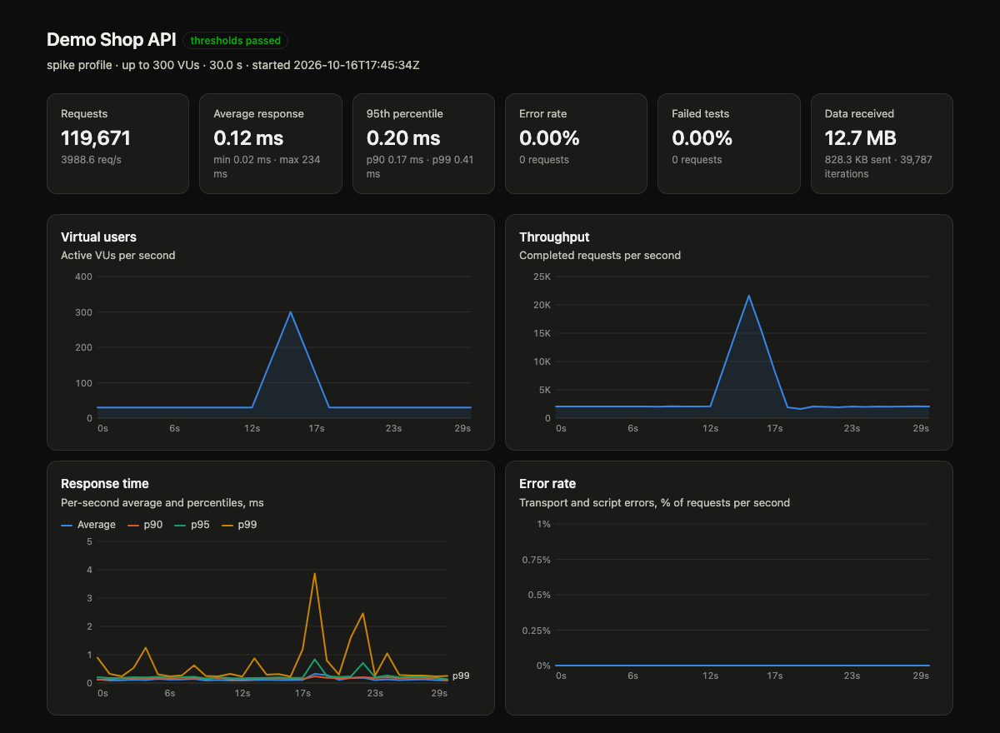

# loadman

**Load-test your Postman collections from the terminal or CI.** Ramp-up,
spike and peak profiles, `pm.test` scripts, pass/fail thresholds, JSON and
HTML reports. One 7 MB binary, no account, no VU-hour bill.

```bash
loadman run shop.postman_collection.json -e staging.json \
  --profile ramp-up --vus 200 --duration 5m \
  --threshold "p95<300ms" --threshold "error_rate<1%" \
  --html report.html
```



## Why

The Postman app has a Performance tab, but it runs inside the desktop app.
Running performance tests headless in the cloud bills
[virtual-user hours](https://learning.postman.com/docs/billing/resource-usage)
on paid plans. Teams that already keep their API flows in Postman collections
end up rewriting them for k6 or JMeter just to run load tests in CI.

loadman runs the collections you already have, as they are:

- **Same mental model as the Performance tab.** Fixed, ramp-up, spike and peak
  profiles with the same default shapes; the same error-rate definition;
  ordered, random, sequential and round-robin data files
  ([how we matched the behaviour](docs/RESEARCH.md)).
- **Your scripts keep working.** Pre-request and test scripts run in embedded
  QuickJS with a `pm.*` API: chaining a login token into later requests,
  `pm.test`/`pm.expect` assertions, `pm.response.to.have.status(...)`.
- **Built for CI.** Thresholds turn a run into a pass/fail exit code. The JSON
  report holds every number, including per-second history.
- **Cheap to run.** Rust, thread-per-core, HDR histograms. It sustains
  ~190k req/s from a laptop, and with scripts on it needs ~57× less CPU per
  request than `postman-runtime` ([benchmarks](docs/BENCHMARKS.md)).

## Install

Prebuilt binaries for Linux (x86_64 and arm64, glibc 2.28 or newer), macOS
(Apple Silicon and Intel) and Windows are attached to each
[release](https://github.com/tranhuuhuy297/loadman/releases). They need no
system CA bundle: without one, `https://` is verified with bundled Mozilla
roots. Or build from source:

```bash
cargo install --git https://github.com/tranhuuhuy297/loadman
```

Or build from source with `cargo build --release`; the binary lands in
`target/release/loadman`.

## Usage

```bash
# What will run? Lists requests, auth, bodies, scripts and missing variables.
loadman inspect collection.json

# Preview a load profile without sending traffic.
loadman profile --profile peak --vus 500 --duration 10m

# 50 VUs for 2 minutes with an environment and a data file.
loadman run collection.json -e env.json -d users.csv -u 50 -t 2m

# Only one folder, with think time between requests.
loadman run collection.json --folder Checkout --think-time 200ms-1s
```

Try it locally against the bundled demo API:

```bash
cargo run --release --example target_server &
loadman run examples/demo/collection.json -e examples/demo/environment.json \
  -d examples/demo/users.csv -p spike -u 300 -t 30s --html report.html
```

### Load profiles

| `--profile` | shape (fractions of `--duration`) | default base load |
|---|---|---|
| `fixed` | `--vus` for the whole run | — |
| `ramp-up` | base until 25 %, linear to max by 50 %, hold | 25 % of `--vus` |
| `spike` | base until 40 %, max at 50 %, back to base at 60 % | 10 % |
| `peak` | base until 20 %, max 40–60 %, base again from 80 % | 20 % |

Override the base with `--base-vus`, draw any shape with
`--stages "0:10,1m:100,4m:100,5m:0"` (absolute `time:VUs` points, linear in
between), or pass a Postman-style load-profile JSON with `--load-profile`.
The VU count is adjusted once per second; each VU runs the selected requests
in order and loops until it is stopped.

### Thresholds and exit codes

`--threshold` takes `metric op value`, e.g. `p95<300ms`, `avg<=0.2s`,
`error_rate<1%`, `rps>=500`. Metrics: `avg min max p50 p90 p95 p99 rps
error_rate http_error_rate assertion_failure_rate requests`.

Exit code `0`: all thresholds passed. `1`: at least one failed. `2`: invalid
input (bad collection, file not found, ...).

```yaml
# .github/workflows/load.yml
- run: loadman run api.postman_collection.json -e ci.json -u 100 -t 3m
       --threshold "p95<400ms" --threshold "error_rate<0.5%" --out load.json --html load.html
- uses: actions/upload-artifact@v4
  with: { name: load-report, path: "load.*" }
```

### Metrics

| metric | meaning |
|---|---|
| response time | send → full body received, ms; avg/min/max/p50/p90/p95/p99 |
| `error_rate` | requests with a transport error (refused, timeout, DNS, TLS, reset) **or** a script error. A 4xx/5xx is not an error by itself, as in Postman |
| `http_error_rate` | responses with status ≥ 400 |
| `assertion_failure_rate` | requests with at least one failed `pm.test` |
| `rps` | completed requests per second over the run |

Percentiles come from HDR histograms (±0.1 % for totals, ±1 % per second).

### Scripts: what is supported

| | |
|---|---|
| Variables | `pm.environment`, `pm.collectionVariables`, `pm.globals`, `pm.variables`, `pm.iterationData` (`get/set/unset/has/clear/toObject/replaceIn`) |
| Request | `pm.request.url/method/headers` (headers can be changed in pre-request scripts), `pm.execution.skipRequest()` |
| Response | `code`, `status`, `responseTime`, `responseSize`, `headers`, `text()`, `json()` |
| Assertions | `pm.test`, `pm.expect` with the common chai chain (`equal/eql/include/property/a/an/above/below/match/lengthOf/keys/oneOf/...`), `pm.response.to.have.status/header/body/jsonBody`, `to.be.ok/success/error/clientError/serverError/json/...` |
| Legacy | `tests[...]`, `responseBody`, `responseCode`, `responseTime`, `postman.setEnvironmentVariable(...)` |
| Misc | `btoa/atob`, `console.*` (shown with `--verbose`), script timeout (`--script-timeout`) |

Not yet: `pm.sendRequest`, `require(...)` modules (crypto-js, lodash, ...),
`setNextRequest`, JSON schema assertions. Calling them records a script
error, so nothing is skipped silently. Also missing: a cookie jar
(`pm.cookies` is empty) and asynchronous tests (`setTimeout` callbacks run
immediately).

Each VU keeps its own copy of the variables, seeded from the collection,
environment, globals, `--env-var` and its data row. Changes made by one VU's
scripts are not visible to other VUs.

### Requests

Collections v2.0/v2.1, nested folders, `{{variables}}` (nested, plus dynamic
ones such as `{{$guid}}`, `{{$randomInt}}`, `{{$timestamp}}`), path
variables, auth inherited from collection and folders (bearer, basic, API
key, OAuth 2 with a stored token), raw/JSON, urlencoded, form-data
(including files), binary and GraphQL bodies, redirects, gzip/brotli/zstd.

`http://` and `https://` requests go over HTTP/1.1 connections that each VU
owns and drives itself, which is cheaper per request than a shared pool. TLS
offers HTTP/2 and HTTP/1.1 like the pooled client does; servers that pick
HTTP/2, proxied requests (`HTTP_PROXY` and friends) and the hops after a
redirect use the pooled client, so HTTP/2 servers still get HTTP/2.
`--no-fast-path` sends everything through the pool.

## Roadmap

- Distributed mode: one controller, many agents, merged report
- Open-model (`--rate`) arrival-rate executor
- `pm.sendRequest`, cookie jar per VU, crypto-js/lodash shims
- Prometheus/OpenTelemetry export, Docker image, Homebrew tap

## How this was built

The behaviour of Postman's Performance tab was studied statically with
[REA](https://github.com/morluto/rea); the process, evidence IDs and
findings are in [docs/RESEARCH.md](docs/RESEARCH.md). loadman is a
clean-room implementation: no Postman code, assets or binaries are included,
and it does not talk to Postman services. Postman is a trademark of Postman,
Inc.; loadman is not affiliated with or endorsed by Postman, Inc.

## License

MIT OR Apache-2.0, at your option.
